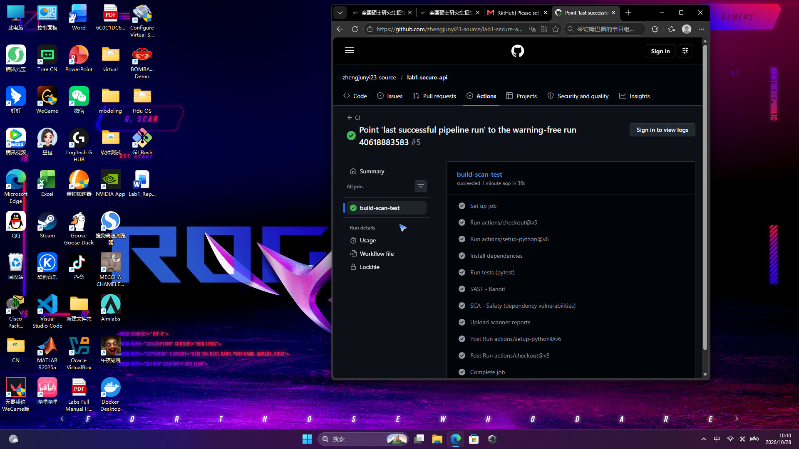
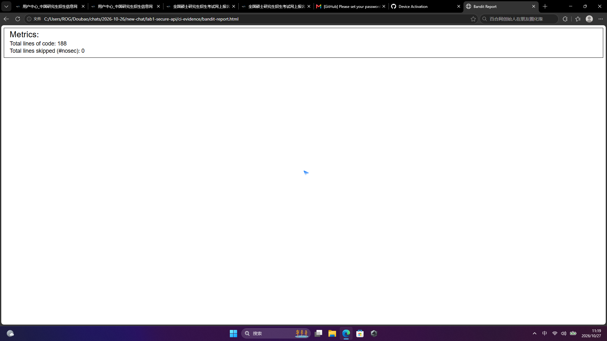

# Secure REST API — Lab 1

**Work 1: Secure REST API Development with CI/CD and Real CVE Vulnerability Analysis**

A minimal, intentionally-*secure* REST API built with **Python + Flask**, protected against the
OWASP Top 10 (SQLi, XSS, Broken Authentication), shipped with a **GitHub Actions** pipeline that
runs SAST (Bandit) and SCA (Safety), and paired with a reproduced-and-fixed real CVE
(**CVE-2020-1938** — Apache Tomcat AJP "Ghostcat") using **Vulhub**.

---

## 1. Project & API description

| Method | Endpoint      | Auth  | Description |
|--------|---------------|-------|-------------|
| POST   | `/auth/login` | No    | Authenticate with `username` + `password`, returns a signed JWT |
| GET    | `/api/data`   | Yes   | Returns the list of all users (JWT required) |
| GET    | `/api/me`     | Yes   | Returns the profile of the currently authenticated user |

### How to call the API

```bash
# 1. Install dependencies
python -m venv .venv
.venv\Scripts\pip install -r requirements.txt   # Windows
# .venv/bin/pip install -r requirements.txt     # Linux/macOS

# 2. Run the server
.venv\Scripts\python run.py                     # serves on http://127.0.0.1:5000

# 3. Login and get a token
curl -X POST http://127.0.0.1:5000/auth/login \
     -H "Content-Type: application/json" \
     -d '{"username":"alice","password":"S3cure#Passw0rd"}'
# -> {"token":"<JWT>","token_type":"Bearer","expires_in_minutes":60}

# 4. Use the token on protected endpoints
curl http://127.0.0.1:5000/api/data \
     -H "Authorization: Bearer <JWT>"

curl http://127.0.0.1:5000/api/me \
     -H "Authorization: Bearer <JWT>"
```

Demo accounts are seeded on first run:

| username | password         | role  |
|----------|------------------|-------|
| alice    | `S3cure#Passw0rd` | admin |
| bob      | `Str0ng!Pa55`     | user  |
| mallory  | `M@llory2024`     | user  |

> `mallory` deliberately has a stored `<script>` string in her `about` field so the XSS
> protection can be demonstrated on output.

---

## 2. Security measures implemented

### 2.1 Protection against SQL Injection (SQLi)

All database access goes through the **SQLAlchemy ORM**, which always binds user input as
**bound parameters** (prepared statements). No raw SQL string concatenation is used anywhere
in the code. For example:

```python
user = User.query.filter_by(username=username).first()
```

The test `test_sqli_parameterised` confirms a payload such as `' OR '1'='1' --` does **not**
bypass authentication.

### 2.2 Protection against Cross-Site Scripting (XSS)

Every string returned to the client is passed through a recursive **output-encoding gate**
(`app/security.py::xss_safe`), which HTML-escapes all string values in the JSON structure
using `html.escape(..., quote=True)`. A stored payload like `<script>alert('XSS')</script>`
is therefore returned as `&lt;script&gt;alert(&#x27;XSS&#x27;)&lt;/script&gt;` and cannot be
executed in a victim's browser. The `test_xss_escaped_on_output` test verifies this.

### 2.3 Protection against Broken Authentication

- **Passwords are never stored in plaintext** — they are hashed with **bcrypt** (salted,
  adaptive, deliberately slow). See `User.set_password` / `User.check_password`.
- **JWT (HS256)** is issued on successful login (`app/security.py::create_token`).
- A **JWT verification middleware** (`@require_token`) protects every restricted endpoint and
  rejects requests without a valid Bearer token with `401`. It also validates the `exp`
  (expiration) and `iss` (issuer) claims.
- Failed logins return a **generic error** so an attacker cannot distinguish a wrong username
  from a wrong password (no user enumeration).

---

## 3. CI/CD pipeline with security scanners

Workflow: `.github/workflows/ci.yml` (GitHub Actions)

Runs automatically on every push to `main` and on every pull request:

1. **pytest** — functional tests for the API.
2. **SAST — Bandit** — static analysis of the `app/` source, producing `bandit-report.html`.
3. **SCA — Safety** — audits `requirements.txt` for known vulnerable dependencies,
   producing `safety-report.json`.
4. Scanner reports are uploaded as build **artifacts**.

The last successful run on `main` (**#4**, commit `4c674c5`) passed all steps with **no warnings** —
functional tests, **SAST (Bandit)** and **SCA (Safety)** — and uploaded the scanner reports as artifacts:



Bandit (SAST) report — **188 lines of code, 0 issues**:



Safety (SCA) report — **7 packages scanned, 0 vulnerabilities**
([`safety-report.json`](ci-evidence/safety-report.json)).

---

## 4. Chosen vulnerability: CVE-2020-1938 (Apache Tomcat AJP "Ghostcat")

- **CVE ID:** CVE-2020-1938
- **Affected:** Apache Tomcat 6.x / 7.x / 8.x / 9.x (AJP connector, default port 8009)
- **Description:** The AJP (Apache JServ Protocol) connector was reachable without proper
  authentication. An attacker could craft a malformed AJP message and read/write arbitrary
  files inside the webapp's `WEB-INF` (e.g. source code, config, or upload a JSP webshell),
  leading to **information disclosure** and, with a webshell, **remote code execution**.

### 4.1 Reproduction (Vulhub)

Environment used: `vulhub/tomcat/CVE-2020-1938` (Apache Tomcat 9.0.30).

```bash
cd vulhub/tomcat/CVE-2020-1938
docker compose up -d        # starts Tomcat; HTTP 8080 + AJP 8009 exposed
# verify AJP is reachable
Test-NetConnection 127.0.0.1 -Port 8009   # -> True

# Run the Ghostcat PoC (crafted AJP forward request) to read WEB-INF/web.xml
python poc.py 127.0.0.1 -p 8009 -f WEB-INF/web.xml
```

Result — the unauthenticated AJP request returns the contents of
`WEB-INF/web.xml` (arbitrary file read):

```xml
<?xml version="1.0" encoding="UTF-8"?>
<web-app xmlns="http://xmlns.jcp.org/xml/ns/javaee" ...>
  <display-name>Welcome to Tomcat</display-name>
  ...
</web-app>
```

> The PoC (`poc.py`) connects directly to the AJP port 8009 and sends a
> `AjpForwardRequest` carrying the attributes `javax.servlet.include.path_info
> = <file>` / `servlet_path = /`. Tomcat's `JspServlet` honors these include
> attributes and reads the requested file without any authentication.

### 4.2 Root-cause analysis

The root cause is a **configuration/logic weakness in the AJP connector**:

- The AJP/1.3 Connector is **enabled by default** on port 8009:
  ```xml
  <Connector port="8009" protocol="AJP/1.3" redirectPort="8443" />
  ```
- It is **not bound to localhost** (`address` not set → listens on all interfaces)
  and has **no `secret`/`requiredSecret`** — i.e. no authentication at all.
- Tomcat **fully trusts** the path, servlet and request attributes supplied by an
  AJP client, so a remote client can point the `JspServlet` at any file inside
  the webapp (`WEB-INF/web.xml`, JSP sources, config) and read it. Combined with a
  file-upload endpoint this even becomes remote code execution (file inclusion).

It is therefore an **improper-input-handling / insecure-default-configuration**
vulnerability: the AJP protocol itself is trusted without authentication, and the
connector is exposed by default.

### 4.3 Applied fix

Because this deployment has no Apache front-end (mod_jk / mod_proxy_ajp), the AJP
connector is not needed, so the fix **disables the AJP connector entirely** in
`conf/server.xml`, and stops exposing port 8009 in `docker-compose.yml`.

Fix files are in the `cve-2020-1938-fix/` folder: `server.xml`, `Dockerfile`,
`docker-compose.yml`, plus `FIX-README.md`.

```bash
cd vulhub/tomcat/CVE-2020-1938
docker compose down          # stop the vulnerable environment
docker compose up --build -d # rebuild with the hardened server.xml (AJP disabled)
```

Verification:

- AJP port 8009 is no longer reachable: `Test-NetConnection 127.0.0.1 -Port 8009` → **False**.
- Re-running the PoC now **fails**:
  ```
  ConnectionRefusedError: [WinError 10061]  # target actively refused connection
  ```
- Regression — the web application still works: `GET http://127.0.0.1:8080/` → **HTTP 200** (Apache Tomcat welcome page).

---

## 5. Useful links

- [Last successful pipeline run](https://github.com/zhengjunyi23-source/lab1-secure-api/actions/runs/40618883583) — run #4, commit `4c674c5`, status **Success, no warnings**
- [Public repository](https://github.com/zhengjunyi23-source/lab1-secure-api)
